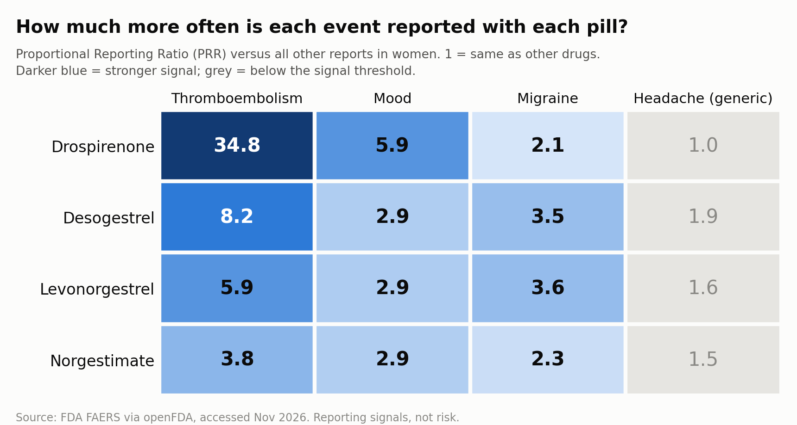

# Oral contraceptives and adverse event reports: a signal detection study in FDA FAERS

We analysed reports to the FDA Adverse Event Reporting System (FAERS) to see whether combined oral contraceptives with different progestins show different patterns of reported adverse events.

## Research question
Do combined pills containing drospirenone, desogestrel, norgestimate or levonorgestrel differ in how often thromboembolism, mood-related events and migraine are reported? Do these signals change with age and over time?

## Data
- **Source:** FAERS, accessed through the openFDA API (November 2026). Female patients only.
- **Pill groups:** defined by brand names as written by the reporter (e.g. Yaz, Yasmin, Sprintec), because the standardised `openfda` fields missed most pill reports. We excluded intrauterine devices and emergency contraception.
- **Group sizes:** drospirenone 45,410 reports; norgestimate 9,924; levonorgestrel 4,784; desogestrel 1,515.

## Method
- For each pill and event group we built a 2×2 table against all other reports in women and computed the **Proportional Reporting Ratio (PRR)** and the **Reporting Odds Ratio (ROR)** with a 95% confidence interval.
- **Signal criteria:** at least 3 cases, PRR ≥ 2 and lower bound of the ROR interval > 1.
- Thromboembolism, a known risk of combined pills, was used as a **positive control**; generic headache as a comparison for migraine.
- We repeated the analysis **within age bands** (10–24, 25–34, 35–44, 45–60) and looked at **reports per year** to check for litigation-driven reporting.

## Key findings
- **Thromboembolism** is a signal for all four pills (PRR 3.8–34.8) and is not explained by age.
- **Drospirenone** reports show a large wave in 2008–2014 (about 85% of its reports), when the share mentioning thromboembolism reached 51–63%, consistent with lawsuits on Yaz and Yasmin. After the wave the share falls to 6–13%, still above the other pills and all reports in women (1–3%): the lawsuits inflated the signal but did not create it.
- **Mood:** the signal weakens within age bands for three pills, but remains for drospirenone (PRR 4.3–5.3).
- **Migraine:** weak signals; the drospirenone signal disappears once age is taken into account.

## Limitations
- Spontaneous reports measure how often events are **reported**, not how often they **happen**. A signal is not proof of causation.
- Pill groups are based on free-text brand names, which can contain spelling variants or refer to concomitant drugs.
- Duplicate reports were not removed, and we have no information on how many women took each pill.

**These are reporting signals, not medical advice. Anyone taking the pill should discuss any concerns with their doctor.**

## Repository structure
- `notebooks/` – the full analysis, step by step, with comments
- `figures/` – the figures used in this README and in the report

## How to reproduce
1. Get a free API key at [open.fda.gov](https://open.fda.gov/apis/authentication/).
2. Open the notebook in Google Colab and save the key in Colab Secrets as `OPENFDA_API_KEY`.
3. Run all cells. Results may change slightly as the FDA updates the data.

## Authors
Sofia Crisafulli and Emily Campanelli. We used Claude (Anthropic) as an assistant for code and for revising the text; the research question, the choices and the interpretation are our own.

Data: FDA FAERS via openFDA, public domain (CC0). This project is not affiliated with or endorsed by the FDA.
